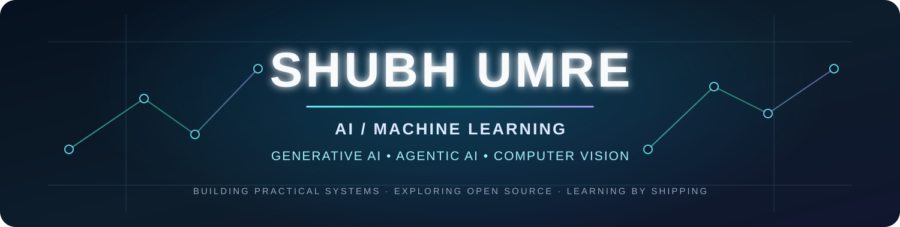
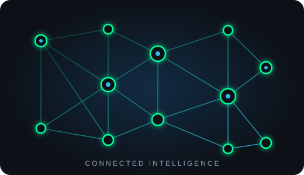
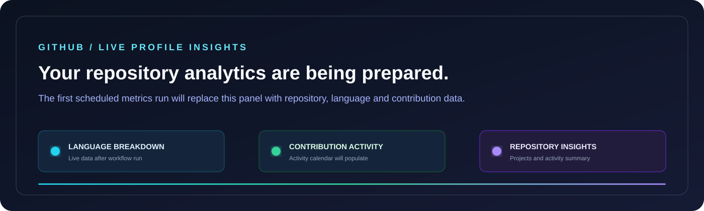

 

  

---

## ✦ Profile

Hi, I'm **Shubh Umre**, a B.Tech undergraduate specializing in **Artificial Intelligence & Machine Learning**.

I build practical AI applications and explore the engineering behind them — from data preparation and model development to retrieval pipelines, intelligent interfaces and deployment.

My current focus is on:

<table>
<tr>
<td width="33%" valign="top">

<h3 align="center">🧠 Applied AI / ML</h3>

Machine Learning Deep Learning NLP Computer Vision Anomaly Detection Recommendation Systems

</td>
<td width="33%" valign="top">

<h3 align="center">✦ Generative AI</h3>

LLM Applications Retrieval-Augmented Generation Embeddings Vector Search Hybrid Retrieval Prompt Engineering

</td>
<td width="33%" valign="top">

<h3 align="center">⚡ Agentic AI</h3>

Agent Workflows LangChain / LangGraph Tool Orchestration ReAct Patterns Conversational Memory Multi-step Reasoning

</td>
</tr>
</table>

  

---

## ◈ Technology Stack

### Languages & Data

### Machine Learning, Deep Learning & Computer Vision

### Generative AI & Retrieval

### Application Development & Tools

---

## 🚀 Selected Projects

A selection of my AI/ML applications and technical resources. Open each repository for implementation details, architecture and setup.

<table>
<tr>
<td width="50%" valign="top">

<h3>01 · NEXUS RAG</h3>

<b>HYBRID RETRIEVAL · GENERATIVE AI</b>

A document-grounded question-answering application. Upload PDF, TXT, DOCX or CSV files and ask questions in natural language. Combines Qwen3 embeddings and FAISS semantic search with BM25 keyword retrieval through LangChain's EnsembleRetriever.

</td>
<td width="50%" valign="top">

<h3>02 · Exam Anxiety & Proctoring AI</h3>

<b>COMPUTER VISION · BEHAVIORAL ANALYTICS</b>

An experimental system that analyzes examination video for face movement, centroid-based motion, fidgeting signals, facial-expression signals and temporal patterns. These signals are combined into an experimental Anxiety Index (0–100).

<i>The index is an experimental behavioral indicator, not a medical or psychological diagnosis.</i>

<a href="https://github.com/shubhumre777/Exam-Anxiety-Detector">Source code</a> · <a href="https://exam-anxiety-detector-su.streamlit.app/">Application</a>

</td>
</tr>
<tr>
<td width="50%" valign="top">

<h3>03 · Aadhaar Biometric Behaviour Intelligence</h3>

<b>UNSUPERVISED ML · DATA INTELLIGENCE</b>

Uses UIDAI demographic and biometric update datasets to study district-level and temporal patterns. The workflow includes data cleaning, monthly aggregation, feature engineering and Isolation Forest-based anomaly detection, with risk views in a Streamlit dashboard.

<a href="https://github.com/shubhumre777/aadhaar-behavior-intelligence">Source code</a> · <a href="https://aadhaar-behavior-intelligence-z6cfp99ncoissjukvbr4mh.streamlit.app/">Application</a>

</td>
<td width="50%" valign="top">

<h3>04 · Spam Message Classifier</h3>

<b>NATURAL LANGUAGE PROCESSING · CLASSIFICATION</b>

A text-classification web app using NLTK preprocessing, TF-IDF feature extraction and a Multinomial Naive Bayes classifier. The project README documents the SMS Spam Collection dataset and a Streamlit prediction interface.

<a href="https://github.com/shubhumre777/spam_email_detection">Source code</a> · <a href="https://spamemaildetection-a5ve47mcinjnq5vnsuakel.streamlit.app/">Application</a>

</td>
</tr>
<tr>
<td width="50%" valign="top">

<h3>05 · Movie Recommendation System</h3>

<b>RECOMMENDER SYSTEMS · NLP</b>

A content-based recommender that converts movie metadata into TF-IDF vectors and uses cosine similarity to find similar movies. The Streamlit interface also uses the TMDB API to retrieve movie posters.

<a href="https://github.com/shubhumre777/Movie-Recommendation-System">Source code</a> · <a href="https://movie-recommendation-s-umre.streamlit.app/">Application</a>

</td>
<td width="50%" valign="top">

<h3>06 · ML Tech Stack Cheatsheets</h3>

<b>VISUAL TECHNICAL RESOURCE · AI / ML</b>

A collection of visual reference sheets covering Python, ML libraries, deep learning, computer vision, NLP, GenAI, RAG, embeddings, vector databases, LangChain, agents, LLM evaluation, fine-tuning, LoRA and MLOps.

</td>
</tr>
</table>

---

## 🌐 Live Applications

 

---

## 📊 GitHub Analytics

 

  

Repository insights, language distribution and contribution activity are generated from GitHub data by GitHub Actions.

---

## ✧ Let's Connect

I'm interested in practical work and collaboration across **Machine Learning, Generative AI, Agentic AI, Computer Vision and open-source software**.

  
  
  

  
  
  
  

